# Server Code

## General Overview

The overview of the server side code can be shown in the following figure.


## Life of A Client Session

Here is an overview of a client session lifecycle from birth to inevitable death. Each thread is
started by the main thread, which spawns it off if the server still has room. Then, a handshake 
is performed. This handshake merely serves the purpose of telling the client their `Client#` 
value. From there, the client is free to either have the server ack them endlessly, or they may 
request the server to send them the contents of whatever files are present in `content/`.


Now, handling the commands does require some finesse, which is where the next section becomes 
relevant.

## The PDA Defining The Client's State

The following PDA (push down automata) is used to describe the state transitions the client 
object goes through over the course of a session. This PDA was formally proven to be correct, 
however the proof goes beyond the requirements for this report.


Each state simply tells the relevant thread what kind of response to send, and whether 
content from a file should be sent. In ECHO mode, the server simply echoes what the 
client sent. In FILE mode, the server treats input as a file name, and checks if the 
file exists in the repository. If yes, the filename is pushed onto the stack and the 
server streams the file's contents, if not, an error is raised and the client must 
try again.

While the language recognized here is technically regular, thus a DFA would have sufficed, an 
equivalent DFA would have required 4 states (instead of just three). This would have significantly 
complicated the code implementation by adding the necessary transitions for the 4th state.

## The Connection Table

The connection table is merely a table tracking the connections to the server. The only 
complication in its design is that a lock is required to read/modify/write it.

# Client Code

## General Overview

The client is just the file client.py using a socket module, its thing and the server owns the protocol states and the client only sends lines and displays what returns.

`CliClient` contains all the logic, with each methods job being the following:

```
open() - opens TCP connection
close() - close reader and socket
text() - sends newline and terminate line
read_header() - parses first line of reply frame
read_body_text() - reads size bytes and decodes them into text
s_file() - streams a file body to disk
handshake() - recieves the assigned name and echoes said name back
handle_reply() - read and displays replt
repl() - this is the read,send,print loop
```

## Session steps:
1. Connect and read name 
2. send name back
3. loop
4. on exit, quit or q we send line and close

## Difficulties faced
1. No message boundaries in TCP, we solved with lentgh in every frame header
2. short reads on large files


# Test Results

Figures 4 through 19 demonstrate:

1. Client Server Over TCP sockets only.
2. Names for client.
3. Clients Send said names once accepted.
4. Client cache with time stamps.
5. Limit of 3 clients.
6. String echo back.
7. Status shows cache.
8. Exit closes connection.
9. List shows repo.
10. stream a file, handle missing file.

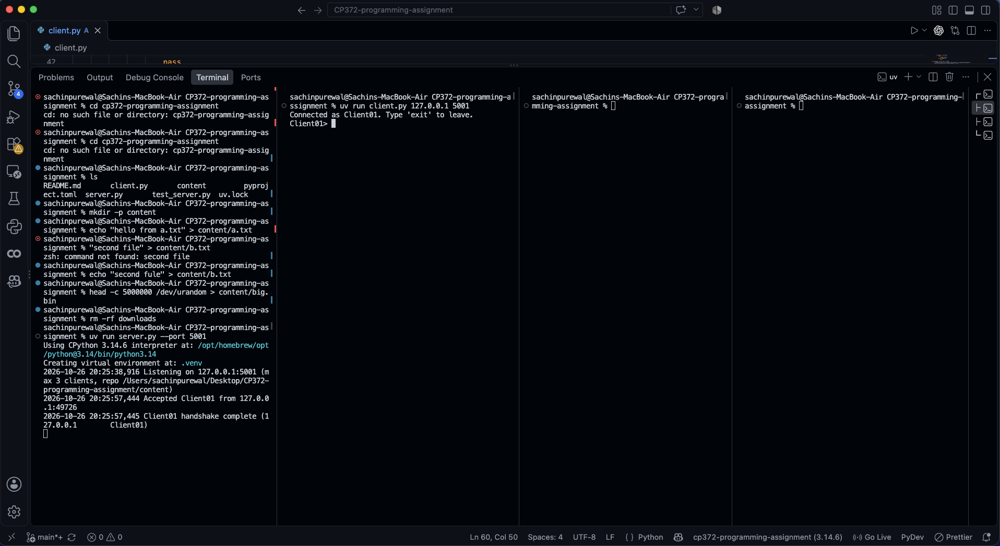

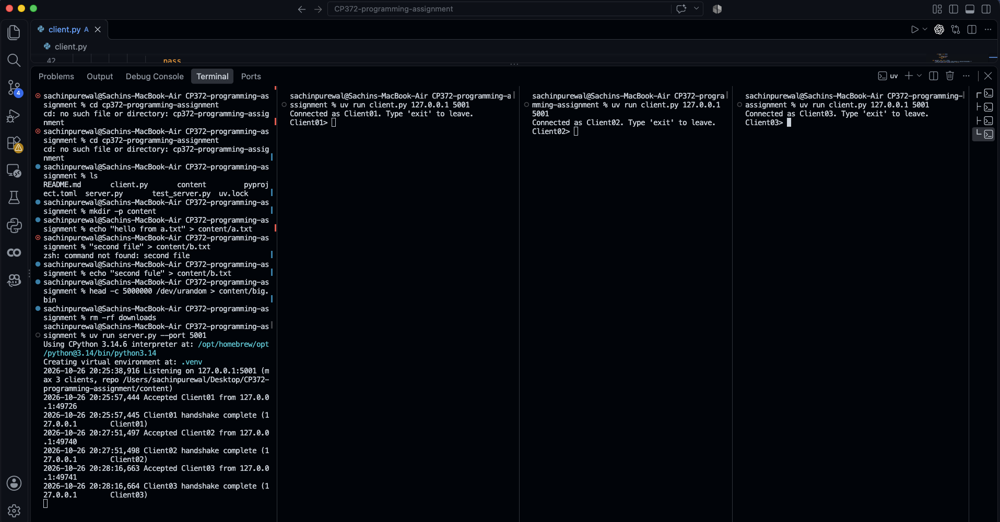


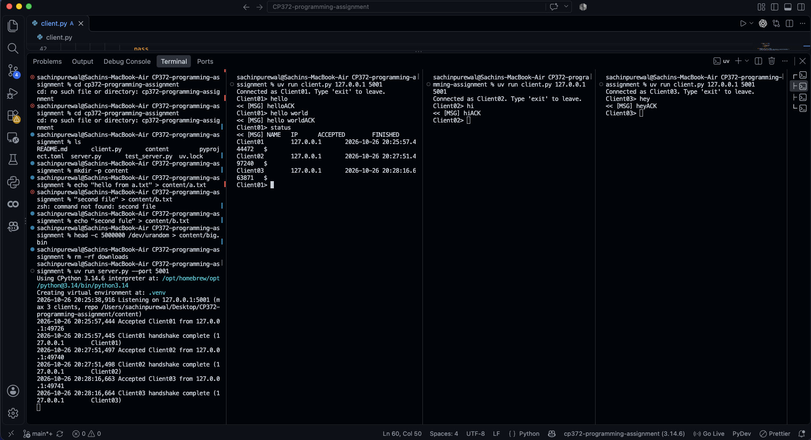

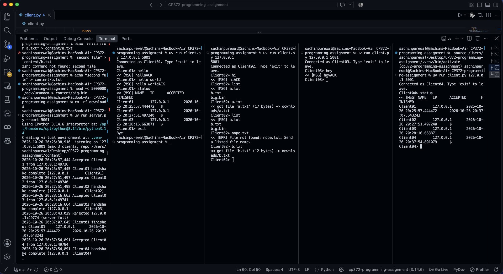

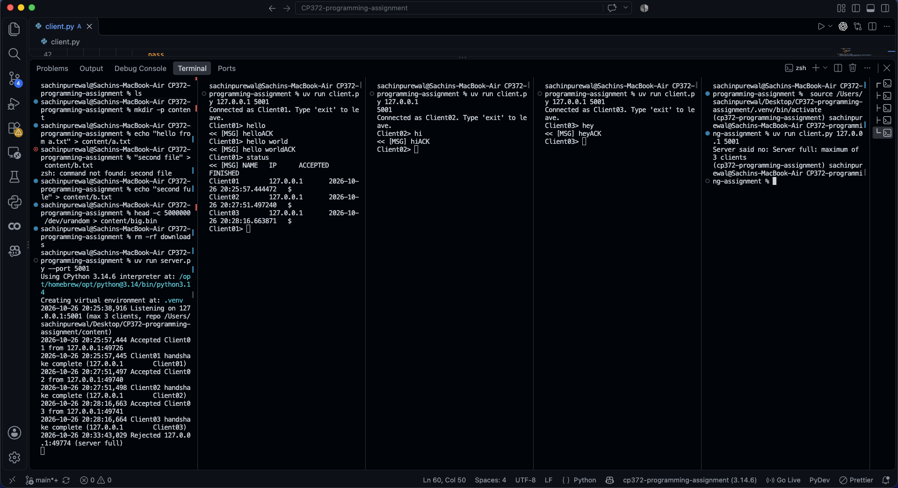

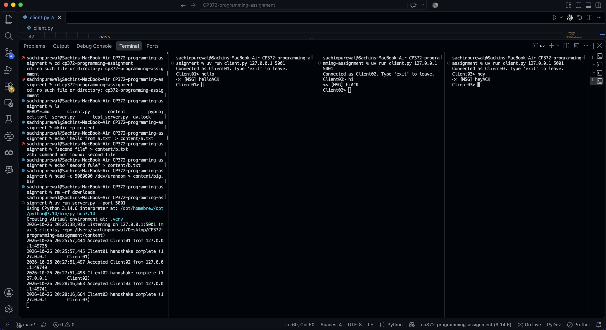


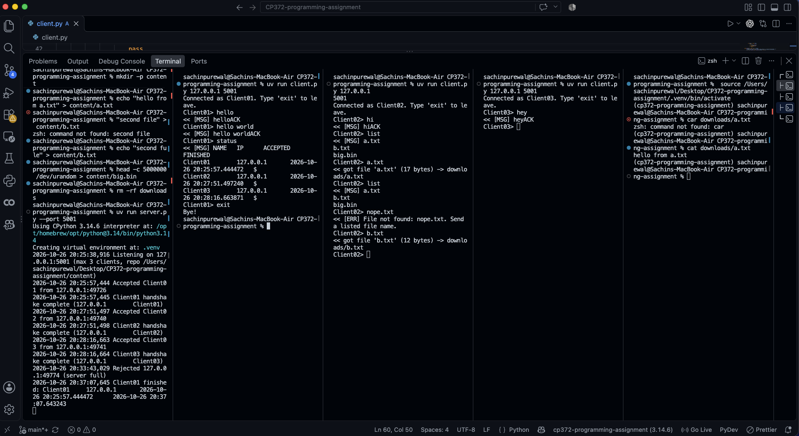

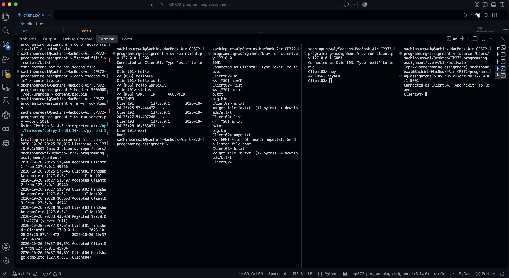

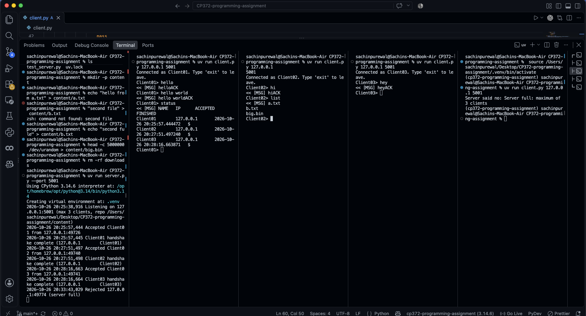

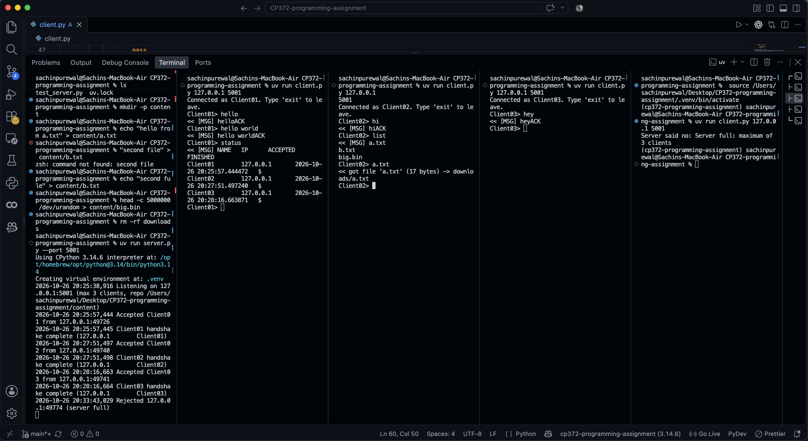

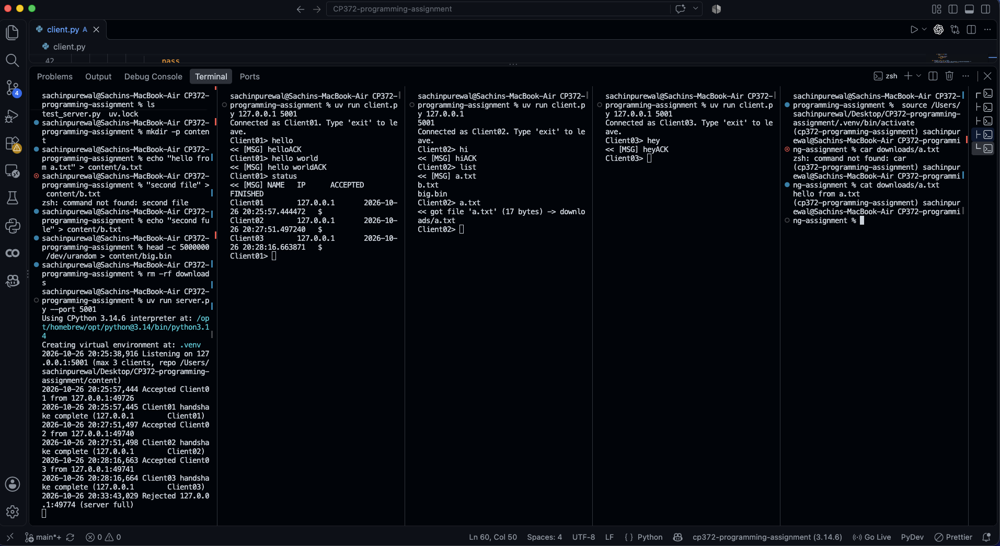

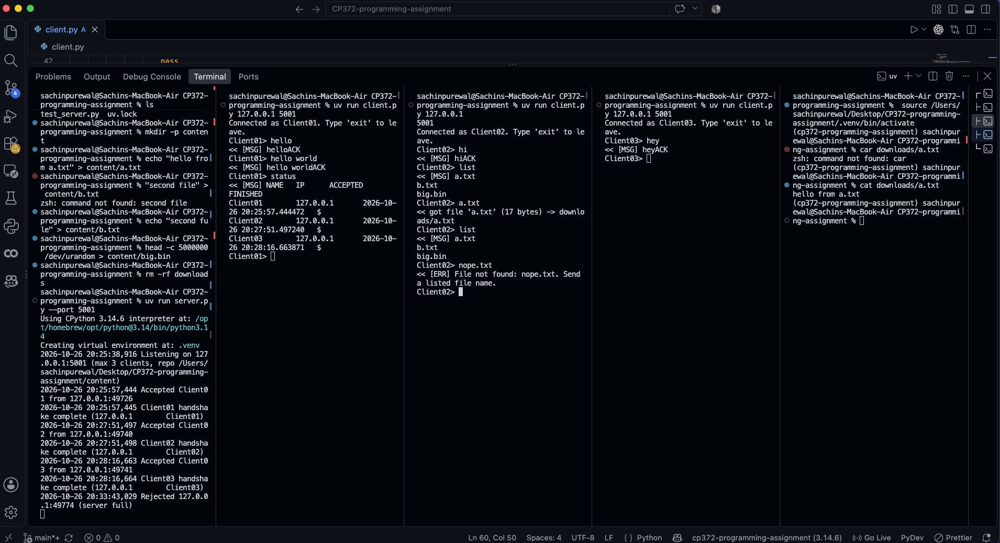

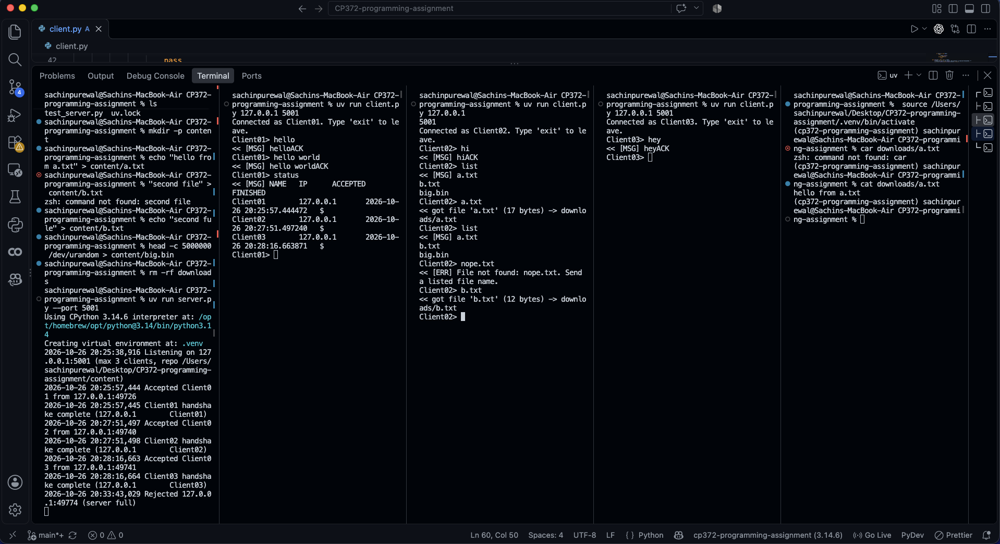

# Possible improvements 
1. Client to client messaging
2. TLS and login

